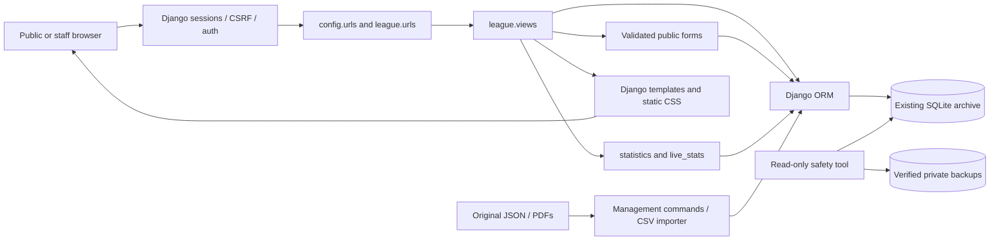
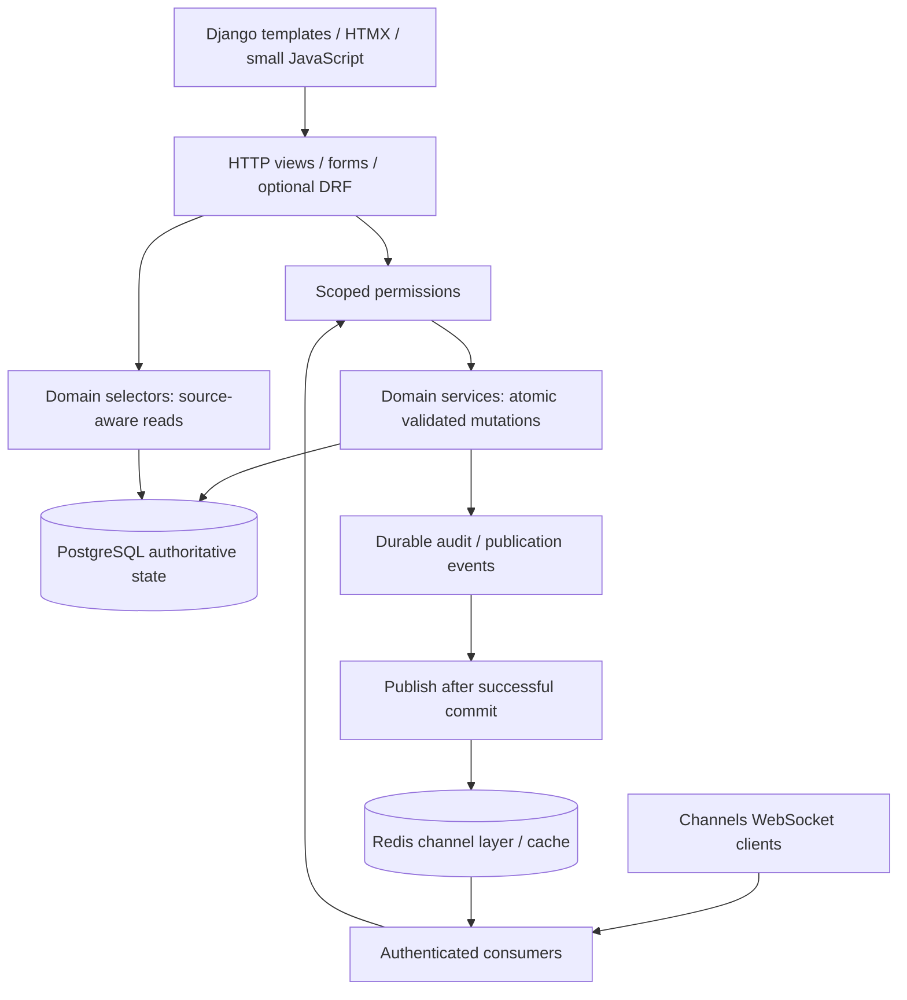

# SPL architecture

## Current application — Phase 1

SPL is a server-rendered Django modular monolith with a single legacy `league` app. No React application, REST framework, Channels, Redis, Celery, or auction subsystem is installed. Preserving working routes/data takes priority over reorganizing every file immediately.

`PlayerMatchStat` is an imported scorecard aggregate and can also be rebuilt from actual live deliveries when those exist. Original `Match.full_scorecard` and `scorecard_text` preserve source detail. **Historical scorecards are not deliveries.** Never silently synthesize deliveries or zero-fill unavailable facts to simplify a chart.

Django supplies auth/session/admin/CSRF. Current custom mutations use staff-level permissions, not the requested granular role system. Backup tools use the Python standard library and are independent of application startup, migrations, or dependencies.

## Planned domain boundaries — Phases 2–8

Extract responsibilities when a working domain requires them, keeping one deployable application and database. Initially retain legacy model table names to avoid unnecessary data migrations.

| Domain | Responsibility |
| --- | --- |
| accounts | Authentication, scoped roles, team ownership, audit actor context |
| tournaments | Season configuration, venues/stages, fixtures, awards |
| teams | Franchise/season identity, squads, captains and retention associations |
| players | Source identities/aliases, profiles and public identity fields |
| matches / scoring | Fixture lifecycle, playing XI, innings, actual delivery events, corrections |
| statistics | Shared source-aware aggregates, standings/NRR, leaderboards and comparisons |
| auctions | Auction state machine, bidding, purses, results, retentions, exports |
| registrations | Private registration data, approval and player-facing tracking |
| sponsors / announcements | Editorial content, sponsors, gallery and announcements |

Complex domains use `services.py` for mutations, `selectors.py` for efficient reads, `validators.py` for invariants, `permissions.py` for server authorization, and `consumers.py` for real-time delivery when implemented. Use forms for server-rendered interactions; add DRF serializers only to concrete API boundaries.

This second diagram is a target design, not current infrastructure. Introduce Celery only for jobs that need durable asynchronous work; a live auction timer should use persisted server deadlines rather than relying on a sleeping worker.

## Decisions and invariants

- PostgreSQL will own permanent auction/scoring state; Redis will carry disposable messages/cache. Clients recover by reading authoritative versioned snapshots.
- Every critical mutation must authorize its actor in the service, validate current state, lock rows in a documented order, apply one transaction, persist audit facts and publish after commit.
- Use idempotency keys and state versions for retryable actions. Row locks are not substitutes for duplicate-request detection.
- Compute derived statistics in reusable selectors. If cached/materialized later, specify event invalidation, version, rebuild procedure and source of truth. Existing innings counters/stat aggregates currently lack those complete guarantees.
- Store legal balls as integers, use fixed monetary units, and distinguish unavailable historical facts from recorded zero.
- Avoid introducing a stored PointsTable when query-derived standings suffice. Partnerships/FOW can derive from genuine deliveries, not reconstructed historical guesses.
- New models/migrations are additive and reversible by default. Data destructive changes or identity merges need explicit user approval.
- Reuse the existing checkout. No Git initialization, commit, push or public deployment was performed.

See [DATABASE.md](DATABASE.md) for schema/recovery, [AUCTION_ENGINE.md](AUCTION_ENGINE.md) for the proposed auction protocol, and [ROADMAP.md](ROADMAP.md) for implementation gates.
