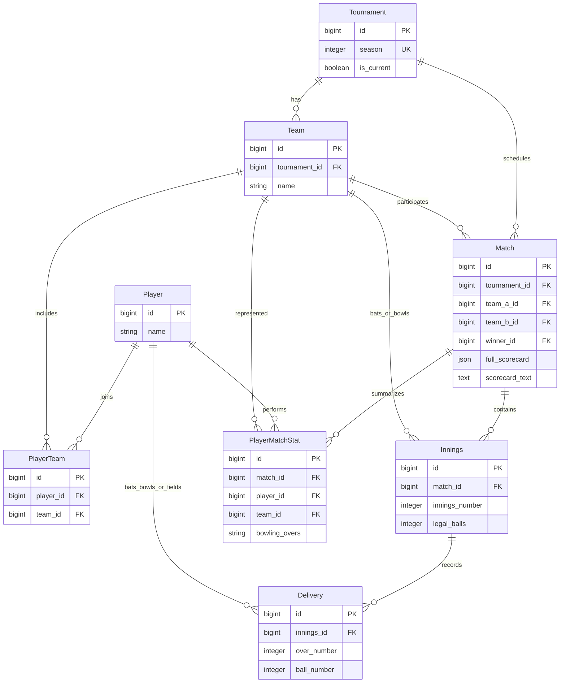

# Database safety and evolution

## Current verified state

SQLite at `db.sqlite3` remains the application default. Phase 1 did not migrate, import into, reset, rename, merge, or otherwise modify it. The source file hash remains `d6d009bccc40ae3a58a2b016ef417c23daa23f1e9ad7b841876fdb55e91111c7`.

Baseline: 3 tournaments, 40 teams, 302 players, 564 memberships, 74 matches, 118 innings, 0 deliveries, 1,810 player-match aggregates, 1 sponsor. Recorded stat totals: 11,686 runs / 6,624 balls faced / 620 wickets / 2,409 dot balls. See the audit for per-season counts.



`PlayerTeam` represents the current implicit many-to-many table `league_player_teams`, not a new model. `Sponsor` and `ContactEnquiry` are independent tables. Auth/admin/session tables also remain intact.

Existing uniqueness: tournament season; team `(tournament, name)`; innings `(match, innings_number)`; player/team membership; stat `(match, player)`. Model-level `choices` do not by themselves create database CHECKs. Current positive-number and JSON-validity CHECKs are included in the schema fixture.

## Verified backup procedure

For the database configured by Django (including alternate `SQLITE_PATH` values), run `python manage.py backup_database`. The Windows helpers use this command and stop on verification failures. Use `--if-exists` only for first-time setup.

The standalone tool runs from the project root using Python 3.12+ with no Django dependency:

```sh
python -m tools.database_safety inspect --database db.sqlite3
python -m tools.database_safety backup --database db.sqlite3 --directory backups
python -m tools.database_safety verify backups/<returned-filename>.sqlite3
```

The command opens the existing source with `mode=ro` and `query_only`, checks integrity and all foreign keys, fingerprints every table in deterministic column order, and takes an online SQLite snapshot in the same read transaction. This captures committed WAL records that a raw file copy could miss. It independently inspects the destination before writing a JSON manifest containing per-table counts/digests, schema digest and backup-file SHA-256.

New backup files are created exclusively with mode 0600; newly created backup directories use 0700. Existing directory permissions are not changed. Each name includes UTC time and a random suffix; repeat runs never replace earlier backups. Failed artifacts are retained for diagnosis and must not be considered verified. **Always run `verify` before recovery or migration.** Checksums detect accidental changes; they are not signed proof against a malicious actor who can also rewrite the manifest.

The Phase 1 backup is in ignored `backups/` alongside its manifest. All tables, including auth/session/private contact data, are included. Keep encrypted/off-device copies with restricted access. No remote upload or scheduled backup service was installed. For unattended use, run the command through the deployment's scheduler, alert on nonzero exit, verify copied artifacts and test restores regularly; implement this in Phase 10.

## Recovery rehearsal — never overwrite the source

1. Stop mutations to the application if investigating real corruption; preserve the suspect database and its WAL/SHM alongside a verified snapshot.
2. Verify the chosen backup with the command above.
3. Copy the **verified backup**, not a running database file, to a **new** path such as `backups/rehearsal.sqlite3`. Refuse an existing destination.
4. Set `SQLITE_PATH` to that new absolute path. Run `manage.py check`, `migrate --plan`, and read-only smoke checks against the rehearsal database.
5. Compare the rehearsal's inspection output with the backup manifest. Confirm entity counts, raw scorecards, relationships, stats and auth behavior using controlled test accounts.
6. Never overwrite the original database as part of a drill. Any real source replacement/cutover needs a separately reviewed recovery plan and approval if destructive.

A separate recovery copy was also checked with Django migrations and compared against every original table fingerprint. No migrations were pending.

Automated tests exercise backup/restore reads, WAL coverage, private modes, unchanged source, multiple unique snapshots, missing-source rejection, FK corruption and tampering. The safety tool intentionally has no restore/delete command.

## Migration lineage recovered in Phase 1

The supplied database recorded `0001_initial` and `0002_match_full_scorecard_playermatchstat`, but their Python files were absent. Their source definitions were reconstructed from current models and the audited SQLite schema, preserving the recorded names. They are reconstructions, not recovered originals. Fresh migrations are checked against `tests/fixtures/legacy_schema.json`, including columns/defaults/PKs/FKs/indexes/CHECKs.

`makemigrations --check --dry-run` reports no changes and the existing database's `migrate --plan` is empty. No fake or destructive baseline migration was used. Do not regenerate migration history during application startup.

## PostgreSQL migration plan — Phase 2, not executed

1. Add PostgreSQL settings/driver and isolated test infrastructure. Obtain target connection settings through environment secrets. Never replace the SQLite file or point test jobs at production.
2. Create and independently verify a fresh SQLite backup. Rehearse only from a copy. Capture a baseline of every table, relationships, per-season counts, stat totals, raw-scorecard text/JSON hashes and player identities.
3. Apply the versioned schema to a **separate empty PostgreSQL database**. Preserve primary keys and foreign keys on transfer, including auth/password hashes, M2M memberships, imported JSON and raw text. Do not import duplicate content types/permissions blindly; reconcile natural keys and existing auth mappings deliberately.
4. Use a documented export/import command with validation, row counts, transaction rollback and sequence reset. Do not treat `dumpdata/loaddata` alone as proof of a complete migration. Check all target invariants after loading.
5. Add integer bowling legal-ball fields as nullable initially. Validate source notation first (`4.5 = 29`); preserve original text and report invalid or unavailable values rather than fabricating zeros. Backfill with explicit source provenance and reversible operations.
6. Add required constraints/indexes and deletion-policy changes after a violation report. Reconcile identities only with reviewed evidence and a reversible mapping. Any destructive correction needs approval.
7. Run PostgreSQL integration tests for row-level locking, atomic bids/scoring, idempotency, rollbacks, NRR and source-aware stats. SQLite test success does not prove these properties.
8. Compare target/source entity counts, IDs/relationships, aggregates, all season/all-time rankings and raw scorecards. Take and verify a PostgreSQL backup and restore it to a separate target.
9. Plan a write-freeze/cutover window and rollback boundary. Do not allow independent writes to SQLite and PostgreSQL during cutover. Switch runtime settings only after verification; keep SQLite and its verified backups.
10. Once PostgreSQL accepts new writes, rollback requires preserving/reconciling those writes. Simply switching back to stale SQLite would lose data.

Store future PostgreSQL backups with `pg_dump` and verify by restoration plus data reconciliation. Redis is never the backup or permanent record of auction/scoring state.
